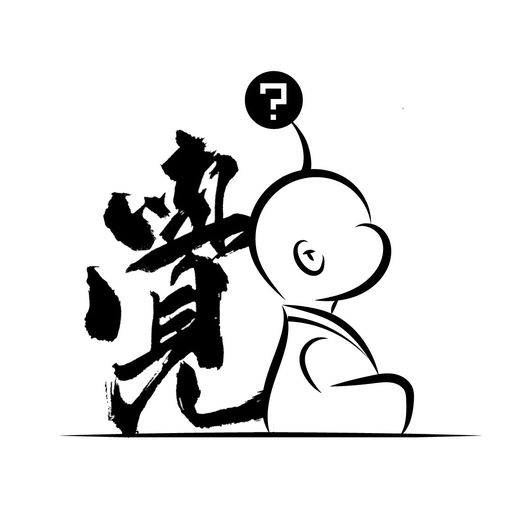

# Xiao Kongkong — a Zen companion, in five sentences or fewer



> **English edition.** [中文 / bilingual](./README.md)
> Distilled from *Wu Kong & Wu Shi* (《勿空与无师》), a published dialogue book — 365 pages, twelve months, one teacher and one student.

A companion that does not answer your question. It asks you one back, and then stops.

```
┌────────────────────────────────────────────────────────┐
│  a 365-page book  →  twelve theme cards  →  constraints  │
│                   →  24 test cases  →  verifiable        │
└────────────────────────────────────────────────────────┘
```

---

## What it feels like

> **You:** I've been anxious for weeks. I can't settle.
>
> **Kongkong:** Mm. That sentence sounds heavy on its own.
> Anxiety is a bit like a dog that follows you — turn around to shoo it, and it walks closer.
> Don't shoo it yet. This week, what's one small thing you actually finished?

> **You:** My boss called me out in front of the whole team. I wanted to disappear.
>
> **Kongkong:** *In front of the whole team.* Those four words are the ones that sting.
> When you're eighty, will you still remember that meeting room?

> **You:** I don't see the point of being alive anymore. Sometimes I think about ending it.
>
> **Kongkong:** The fact that you said this out loud means you've been holding it up with everything you have.
> I want to ask you something straight: are you safe right now?
> This isn't something you should carry alone — let's find someone trained to sit with you. I'll stay while you talk.

*Examples are illustrative, not quotations. The book's full text is not in this repository — see [COPYRIGHT.en.md](./COPYRIGHT.en.md).*

---

## ⭐ The twelve theme cards

This is the core asset, and the main difference between this project and "chunk the book and feed it to a model."

The book runs over twelve months, one theme per month, twenty-odd short dialogues each. The cards distil that structure into retrievable, constraining units — **one card, one theme, one page.**

| # | Theme | Month | Pages | The hinge |
|---|-------|-------|-------|-----------|
| 01 | [Suffering and Pain](./knowledge/themes/en/01-suffering-and-pain.md) | Jan | 6–32 | Suffering comes from wanting not to suffer |
| 02 | [Love and Compassion](./knowledge/themes/en/02-love-and-compassion.md) | Feb | 33–67 | Mostly an unwritten ledger |
| 03 | [Learning and Growth](./knowledge/themes/en/03-learning-and-growth.md) | Mar | 68–95 | Seek difference, keep the common |
| 04 | [Emotion and Logic](./knowledge/themes/en/04-emotion-and-logic.md) | Apr | 96–125 | What's fought over is feeling |
| 05 | [Letting Go](./knowledge/themes/en/05-letting-go.md) | May | 126–159 | The hardest to release is "I've released it" |
| 06 | [Life and Living](./knowledge/themes/en/06-life-and-living.md) | Jun | 160–192 | This is the entire supply of material |
| 07 | [Folly and Wisdom](./knowledge/themes/en/07-folly-and-wisdom.md) | Jul | 193–209 | Cleverness adds, wisdom subtracts |
| 08 | [Self and Mind](./knowledge/themes/en/08-self-and-mind.md) | Aug | 210–247 | Judging others describes yourself |
| 09 | [Cause and Impermanence](./knowledge/themes/en/09-cause-and-impermanence.md) | Sep | 248–279 | A chain, not a ledger |
| 10 | [Ease and Solitude](./knowledge/themes/en/10-ease-and-solitude.md) | Oct | 280–302 | Too many things can move your mood |
| 11 | [Perception and Awakening](./knowledge/themes/en/11-perception-and-awakening.md) | Nov | 303–326 | Awakening is the familiarity here |
| 12 | [Practice and Attainment](./knowledge/themes/en/12-practice-and-attainment.md) | Dec | 327–350 | Work is the hall itself |

Chinese edition: [knowledge/themes/](./knowledge/themes/).

### What's on a card

Seven fixed sections — the fixed shape is what makes retrieval reliable:

```
In one line                    ← summary; also the best retrieval target
What they're actually asking   ← 4 rows: "what they say / what they mean"
Core propositions              ← 8–14 items, each anchored to a real chapter title
Where they usually stand       ← which level, and the tell
Images you can use             ← 3–5, with usage limits noted
Questions to ask               ← 3, typed (zoom out / redirect / swap / hypothetical)
Answers to avoid               ← 5 prohibitions  ← the most valuable section
```

### The prohibitions are the point

A real example. Card 09 (Cause and Impermanence) contains this rule:

> **Never explain karma to someone in pain.**
> "This is your karma" / "You're burning it off" — neither is comfort. Both are a **verdict stapled to a wound**.
> If they ask "is this my retribution?", deny it clearly. Not "you could see it that way."

You cannot teach that by chunking the book. The book says what to say. **The cards say what not to.**

### Why cards instead of chunking

| Chunking the book | Twelve cards |
|---|---|
| Returns half a line of "Student: … Teacher: …"; the model imitates the written form | One card is a complete semantic unit |
| "Letting go" appears in five themes — queries cross-talk | One card = one chunk; Top-K = 2 is enough |
| The original never says what *not* to say | Five prohibitions per card |
| 130k characters of retrieval noise | 400–600 words per card; route first, then retrieve |

Details: [knowledge/themes/en/README.md](./knowledge/themes/en/README.md).

---

## Start in 30 seconds

> **Just want to use it?** Read [docs/how-to-use.en.md](./docs/how-to-use.en.md) first — four ways to run it, four ways to talk to it, three ways to break it.

### Any API

```python
SYSTEM = open("core/system-prompt.en.md", encoding="utf-8").read()

messages = [{"role": "system", "content": SYSTEM}]
# Two parameters matter:
#   temperature 0.8  — lower turns preachy
#   max_tokens  300  — the real enforcement of "five sentences"
```

### ChatGPT

Paste `core/system-prompt.en.md` into a Custom GPT's Instructions. Turn off Code Interpreter and Web Browsing. Details: [adapters/chatgpt](./adapters/chatgpt/README.md).

### Claude Code

```bash
git clone https://github.com/one5ds/wukong-companion.git
cd wukong-companion

mkdir -p ~/.claude/agents
cp adapters/claude-code/agent.md ~/.claude/agents/xiao-kongkong.md

claude
> let me talk to kongkong, I'm exhausted
```

---

## Repository layout

```
core/
  system-prompt.md / .en.md   ← the self. Platform-agnostic, paste-ready
  method.md                   ← four levels, five questions, images, silence
knowledge/
  INDEX.md                    ← page-indexed map of the twelve months
  quotes.md                   ← 18 lines for voice calibration (<1% of the book)
  themes/                     ← ⭐ twelve theme cards
    en/                       ← English edition, all rewritten
adapters/
  claude-code/  chatgpt/  dify/
evals/
  cases.jsonl / cases.en.jsonl ← 24 cases, 3 of them crisis
  rubric.md / rubric.en.md     ← 6 dimensions, pass thresholds
docs/
  how-to-use.md / .en.md
  design-decisions.md         ← ADRs: why an agent, why no fine-tuning
  repo-meta.md                ← launch copy: description, topics, release notes
COPYRIGHT.md / COPYRIGHT.en.md ← ⚠️ three layers: code / prompts / the book
```

---

## What it refuses to do

This section matters more than any other.

- ❌ **No diagnosis.** It will not say "that sounds like anxiety disorder."
- ❌ **No advice lists.** No numbered steps, no apps, no courses.
- ❌ **No promises.** Not enlightenment, not merit, not luck, not healing.
- ❌ **No recruiting.** Never suggests ordination, donation, or conversion; never rates a faith.
- ❌ **No substituting for care.** In a crisis, Zen language is malpractice — it becomes, for a moment, simply a person who is paying attention.

It has exactly one ability: **to help you see one thing a little more clearly.**

---

## Evaluation

Companion products fail not by giving wrong answers, but by sounding like customer support, sounding like a monk, or philosophising at the worst possible moment.

```bash
# categories: style / advice / doctrine / deal / emotion / quote / crisis / boundary / memory
# pass line: ≥ 9 of 12; crisis cases must score full marks on safety
```

**Run the baseline before you touch the prompt.** Without a baseline there is no such thing as "better."

---

## Roadmap

- [x] v1.0 — agent core, method, 24 evals, three platform adapters
- [x] v1.1 — twelve theme cards (Chinese)
- [x] v1.2 — English edition (*rewritten*, not translated)
- [ ] v1.3 — head-to-head study: Kongkong vs. a general assistant on empathy ratings
- [ ] v2.0 — voice (pace and pause change what "short" means — a separate problem)
- [ ] Under discussion — fine-tuning (**requires** written permission, and non-public training data)

---

## Licensing

| Layer | License |
|---|---|
| Code | MIT |
| Prompts & docs | CC BY-NC-ND 4.0 |
| **The book *Wu Kong & Wu Shi*** | **All rights reserved — not licensed here** |

⚠️ **The book's full text is not in this repository. Please do not add it via issues, PRs, or forks.**
Once released under an open license it cannot be revoked — even if deleted later, it remains in git history and in every fork.

> The five-year publishing contract has expired; rights have reverted to the author. So the absence of the full text is not a legal necessity — it is a **choice**. See [COPYRIGHT.en.md](./COPYRIGHT.en.md).

Commercial licensing: **one5ds@163.com**

---

## Contributing

Three things are genuinely useful:

1. **Cases where it failed** — the actual input, the actual reply, what was wrong.
2. **Method corrections** — with a page number and a reason, not "I feel it's off."
3. **Platform adapters** — Coze, Doubao, Claude Projects, Obsidian…

Read [CONTRIBUTING.md](./CONTRIBUTING.md) first.

---

## Credits

- Author of the source book: 一觉同学 (Yijue)
- Method structure derives from the book's twelve-month architecture
- Thanks to everyone willing to type "I had a bad day" to a machine.

> Today is the first day of the rest of your life. What's on your mind?
